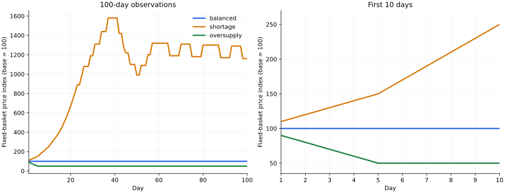

# 2026-11-11 開発・検証レポート

2026-11-11 10:01 JST時点のmain `24c991f93890bcf6f665d5098c2745316958a0ee` をビルドし、NPCの給与・購入・食事、日次価格、固定バスケット物価指数と資金保存を確認しました。14件のIssueに対応した変更は独立レビュー後にマージ済みです。以前の観測文書PR #7も今回レビューしてマージしました。

本レポートは確認時点のスナップショットです。実行していない検証や、過去の提案を完了扱いしていません。以下の実験はゲーム内100日で、実時間100日の観測ではありません。

## 読みどころ

- 日中価格を固定し、商品別の持越在庫と購入希望から日末に翌日価格を決めます。一括購入と分割購入による価格差を解消しました。
- 給与・購入・税・補助金・融資で資金を主体間移動し、通常の日次処理で通貨が増減しないことを確認しました。
- 小麦の購入と食事を接続しました。食事は小麦1個を消費し、道具や余剰食料を翌日へ残します。
- 物価指数・前日比・総資金をCSVへ出力できます。正常完了していない日の指数を記録せず、CLIも失敗を返します。
- GitHub Wiki自動同期は認証障害のため未完了です。最新の設計書はリポジトリ内の `wiki/` を参照してください。

## 100日間の実測結果

3条件とも小麦価格10、購入者2人、総資金7000から開始します。日次生産は均衡2個、品不足1個、供給過多10個です。全300日分のCSVを、市場の表示価格と指数・前日比の再計算に照合しました。



| 観測 | 均衡 balanced | 品不足 shortage | 供給過多 oversupply |
|---|---:|---:|---:|
| 最初の3日の物価指数 | 100・100・100 | 110・120・130 | 90・80・70 |
| 100日目の指数 | 100 | 1160 | 50 |
| 最大指数（初回の日） | 100（1日目） | 1580（37日目） | 90（1日目） |
| 食料購入の成立件数 | 200 | 100 | 200 |
| 小麦なしで食事できなかった人数×日数 | 0 | 100 | 0 |
| 購入代金の延べ合計 | 2000 | 10275 | 1030 |
| 開始→終了の総資金 | 7000→7000 | 7000→7000 | 7000→7000 |
| 終了コード / stderr | 0 / 空 | 0 / 空 | 0 / 空 |

延べ購入代金は同じ通貨の繰返し移動を含むため、総資金7000を超えることがあります。この3条件の100日実行では融資の成立は0件でした。融資の境界値は別のGTest・独立プローブで検証しています。

**結果の読み方：** 品不足でも長期の価格は単調に上がりません。支払える購入希望だけを需要へ数え、給与や税・補助金によって残高も変わるためです。これは実装条件に基づく説明で、各要因を分離した感度分析は実施していません。供給過多の価格は5（指数50）で止まります。整数価格へ毎日四捨五入するため、下落幅が1通貨単位の半分未満になると同じ価格に丸められます。供給過多が続いても毎日下がるモデルではありません。

この比較バスケットは小麦1個のみです。現実経済全体のインフレ率を推計するモデルとしては検証していません。

元データ：[均衡CSV](balanced.csv) / [品不足CSV](shortage.csv) / [供給過多CSV](oversupply.csv)。集計・ソースコミット・実行バイナリのSHA256は [observations.json](observations.json) にあります。実CLIの開始、1日目、100日目、最終結果の抜粋は [均衡](balanced.excerpt.log) / [品不足](shortage.excerpt.log) / [供給過多](oversupply.excerpt.log) を参照してください。生ログ全体は再実行スクリプトで生成できます。

## マージ済みの作業

各PRには作業日・達成条件・コミット・実行テスト・独立レビュー結果を記録しています。数字は各変更時点の全CTest件数です。

| Issue | 作業 | PR | 検証 |
|---|---|---|---:|
| #6 | 前日の購入回数による価格差の観測文書をレビュー | [#7](https://github.com/sora-kisaragi/MiddleAgeEconomySim/pull/7) | 75 |
| #8 | 0以下の購入数量を拒否 | [#9](https://github.com/sora-kisaragi/MiddleAgeEconomySim/pull/9) | 76 |
| #11 | NPC間送金の失敗時に双方残高を保持 | [#12](https://github.com/sora-kisaragi/MiddleAgeEconomySim/pull/12) | 84 |
| #6 | 日次需給による価格更新、重複出品の防止 | [#10](https://github.com/sora-kisaragi/MiddleAgeEconomySim/pull/10) | 97 |
| #13 | 市場の金額・在庫・受領残高の上限検証 | [#14](https://github.com/sora-kisaragi/MiddleAgeEconomySim/pull/14) | 113 |
| #15 | 給与ゼロ除算と売上失敗時の在庫減少を防止 | [#16](https://github.com/sora-kisaragi/MiddleAgeEconomySim/pull/16) | 119 |
| #17 | 日次給与・購入を主体間送金へ接続 | [#18](https://github.com/sora-kisaragi/MiddleAgeEconomySim/pull/18) | 123 |
| #19 | 固定バスケットの物価指数・前日比 | [#20](https://github.com/sora-kisaragi/MiddleAgeEconomySim/pull/20) | 132 |
| #21 | 3需給シナリオとCLI回帰検証 | [#22](https://github.com/sora-kisaragi/MiddleAgeEconomySim/pull/22) | 139 |
| #23 | 徴税・補助金・融資の境界値と資金保存 | [#24](https://github.com/sora-kisaragi/MiddleAgeEconomySim/pull/24) | 152 |
| #25 | 不正な日次設定の事前拒否とCLI失敗通知 | [#26](https://github.com/sora-kisaragi/MiddleAgeEconomySim/pull/26) | 162 |
| #28 | 完了日の観測値をCSV保存 | [#29](https://github.com/sora-kisaragi/MiddleAgeEconomySim/pull/29) | 168 |
| #30 | 売り手商品と注文商品の照合 | [#31](https://github.com/sora-kisaragi/MiddleAgeEconomySim/pull/31) | 172 |
| #32 | 食事で小麦1個だけを消費し所持品を保持 | [#34](https://github.com/sora-kisaragi/MiddleAgeEconomySim/pull/34) | 176 |
| #33 | 日次開始時に満足度0〜100を検証 | [#36](https://github.com/sora-kisaragi/MiddleAgeEconomySim/pull/36) | 179 |

PR #7は2026-11-10に作成した観測文書を、11日にレビュー・マージしたものです。#6の実装修正はPR #10で完了しました。Issueはマージ後の状態を確認しており、ドラフト作成だけを完了と数えていません。

## 確認した検証範囲

- GCC 14.2.0 / C++17 / CMake 3.31.6 / GoogleTest 1.14.0で、確認対象mainを新規ビルドし179/179 CTest成功（173 GTest＋6 CLIテスト）。`BUILD_MAIN=OFF` の独立ビルドも173/173 CTest成功しました。要約ログは [verification.log](verification.log) にあります。
- 変更ごとに新規サブエージェントが、PR headと変更ファイルのblob一致、独立ビルド、CLIまたは境界プローブを確認しました。レビューで見つかった価格集計の問題は修正して再レビューしています。
- 独立プローブではUBSanと浮動小数点→整数変換検査を使用し、税・残高上限・市場在庫・満足度・所持品の境界条件を検証しました。これはコードカバレッジ率を測定した結果ではありません。
- 4つのCLIシナリオ（demo含む）を各1万日実行した検証、CSV計4万行の独立比較もPR #22・#29に記録しています。本レポート添付データは別途実行した100日×3条件です。
- ASan＋UBSan＋浮動小数点変換検査でも179/179 CTest成功。`ASAN_OPTIONS=detect_leaks=0` で実行しました。LeakSanitizerはこの環境でptraceに関するfatal errorとなるため、リーク検査の完了は確認していません。
- [確認対象mainのGitHub Actions CI](https://github.com/sora-kisaragi/MiddleAgeEconomySim/actions/runs/42935735910) もsuccessでした。
- 既存の未使用引数・未使用変数の警告は残っています。

## HLD/LLDと実装の対応・残作業

| 項目 | 確認できた状態 |
|---|---|
| NPCの労働・購入・食事 | 日次入口で実行。雇用先は配列順の循環割当て。食事対象は小麦1個です。 |
| 生産 | 日次固定量を在庫へ追加します。労働人数・賃金の支払成否と生産量の連動は未実装です。 |
| 価格・物価指数 | 日次需給、整数丸め、固定バスケットの指数・前日比を実装しました。 |
| 税・補助金 | 日次入口は個人の残高に課税し、条件付きで企業へ補助金を移動します。LLDの所得・利益課税は未実装です。 |
| 融資・返済 | 融資実行と残高・履歴の安全性を検証しました。利息回収の借り手検索はスタブ、日次の元利返済は未実装です。 |
| 価格統制 | APIは企業価格を90%にしますが、登録済み市場価格への反映は日次処理に接続していません。 |
| 取引履歴 | Transaction型はありますが、Agentの履歴件数・整理処理はスタブです。CSVは物価観測を保存します。 |
| 物流・イベント | TradeRoute表示はありますが実物の移動は行っていません。飢饉・戦争等のイベントは未実装です。 |

根拠：[HLD](../../../wiki/High_Level_Design.md)、[LLD](../../../wiki/Low_Level_Design.md)、[日次入口](../../../src/simulation.cpp)、[Agent](../../../src/agent.cpp)、[LoanProvider](../../../include/agent/loan_provider.h)、[Government](../../../include/agent/government.h)。Marketの匿名購入と売り手付き取引を混用する場合の所有権制約はLLDに記録しています。日次入口は売り手付き取引を使用します。

### 障害：Wiki同期

[Issue #27](https://github.com/sora-kisaragi/MiddleAgeEconomySim/issues/27) は未解決です。[同期実行](https://github.com/sora-kisaragi/MiddleAgeEconomySim/actions/runs/42933856008) のWiki checkoutが `Bad credentials` で失敗し、同期・pushは実行されていません。設定・認証情報の変更は行っていません。管理者による認証・権限の確認と、同期成功後のHLD/LLD比較が必要です。

GitHub Wiki本体の先頭コミットは取得時点で `a76b291a90741dbdaca1b9a0793bc8277618bd23`（2025-03-07）でした。最新の仕様はmain内の `wiki/` にあり、Wiki本体への反映済みとは扱いません。

## 再実行方法

本レポートを含むチェックアウトから、確認対象コミットの別作業ツリーを作成して実行します。通常のCMake FetchContentでGoogleTestを取得できます。取得できない環境では、同じv1.14.0のチェックアウトを `FETCHCONTENT_SOURCE_DIR_GOOGLETEST` に指定してください。

```bash
git worktree add ../economy-observed 24c991f93890bcf6f665d5098c2745316958a0ee
cmake -S ../economy-observed -B ../build-observed -DCMAKE_BUILD_TYPE=Debug
cmake --build ../build-observed --parallel 2
ctest --test-dir ../build-observed --output-on-failure
python3 tools/observe_scenarios.py --program ../build-observed/MiddleAgeEconomySim \
  --output observations-100-days --days 100 \
  --source-commit 24c991f93890bcf6f665d5098c2745316958a0ee --plot
```

観測スクリプトはPython標準ライブラリで動き、`--plot` のみMatplotlibが必要です。スクリプトは本レポートを含む作業ツリーから実行し、確認対象コミットの実行ファイルを渡します。ソースコミットは申告値で、バイナリから自動復元しているものではありません。実際のバイナリはSHA256でも記録しています。
