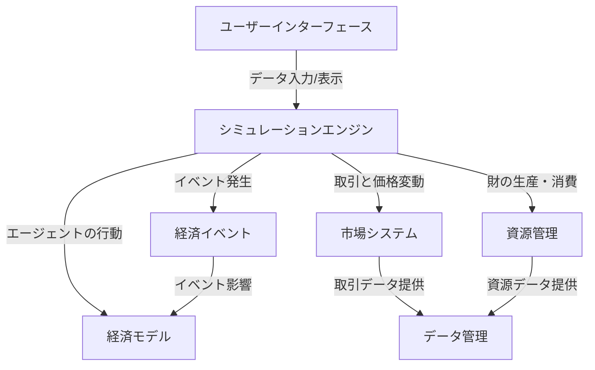
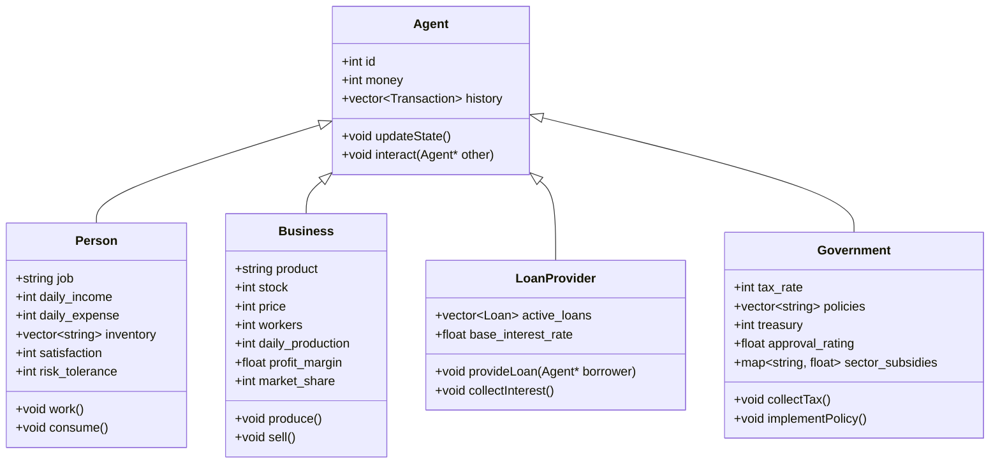
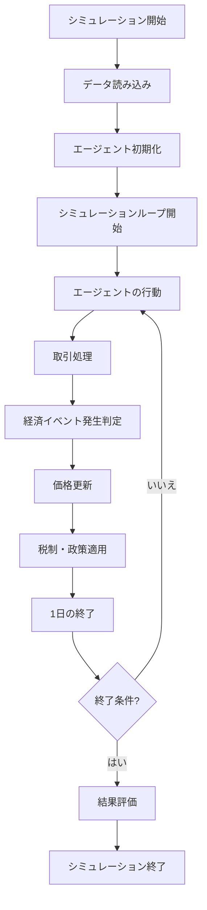
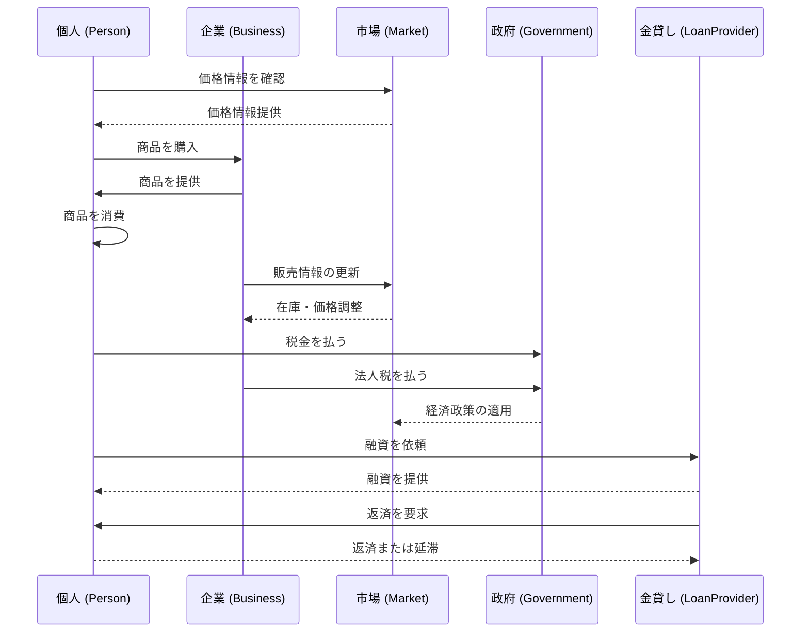

### `High_Level_Design.md`（基本設計書）

# High-Level Design (HLD)

## 1. システム概要
本システムは、中世近代を舞台にしたファンタジー世界の貨幣経済シミュレーションを実装する。  
フェーズ1では、基礎的な経済活動（生産・消費・取引）をシミュレーションし、エージェントが行動する仕組みを構築する。

---

## 2. システムアーキテクチャ
本システムは、C++ を用いたシミュレーションエンジンを中心に構成される。



- **シミュレーションエンジン**: エージェントの行動を管理し、経済モデルを実行する
- **経済モデル**: 需要と供給を元に市場の動きを決定
- **市場システム**: 価格変動や取引処理を担当
- **資源管理**: 財の生産・消費を管理
- **経済イベント**: 飢饉、戦争などのランダムイベントを管理
- **データ管理**: 取引ログやエージェントデータを管理（フェーズ1ではローカルメモリ）

---

## 3. エージェントの構造

②会計設計の共通確定入口は `SettlementService` とする。登録簿に属する
口座の現金移転を候補状態へ適用し、保存則の検証後に残高・状態版・
CommandIdの結果を一括公開する。初期実装はメモリ内の複数先送金までで、
既存Agent／市場／日次CLIへの移行、商品・契約の複合決済、永続化は後続である。
この入口の残高を既存 `Agent.money` と同期する二重正本は作らない。

商品加工も同じ入口の候補状態へ接続し、登録Recipeに従う原料・完成品・
設定済み労働枠を一括確定する。現金と商品でCommandIdと状態版を共有する。
生産・移転・消費・廃棄も同じ商品台帳へ確定し、加工を含む商品別の
増減理由と数量を資産状態と一括公開する。期首と確定履歴から主体別収支を再計算できる。
旧事業・市場・日次経路への在庫移行と、有給労働・能力・道具の結合は後続とする。

各エージェントは、職業や経済行動に基づいた属性を持つ。



- **Person（個人）**: 労働、消費、貯蓄、交易を行う
- **Business（企業）**: 生産、雇用、販売、価格設定を行う
- **LoanProvider（金貸）**: 融資、利息徴収を行う
- **Government（政府）**: 税の徴収、価格制御、政策実施を行う

---

## 4. システムフロー

シミュレーションのメインループとエージェントの行動サイクルを示す。



---

## 5. データの流れ

エージェント間の相互作用と基本的な取引プロセスを示す。



### 5.1 データ構造

各エージェントや市場、交易システムのデータ構造を示す。

```cpp
struct Person {
    int id;
    int money;
    std::string job;
    int daily_income;
    int daily_expense;
    std::vector<std::string> inventory;
    int satisfaction;
    int risk_tolerance;
};

struct Business {
    int id;
    int money;
    std::string product;
    int stock;
    int price;
    int workers;
    int daily_production;
    float profit_margin;
    int market_share;
};

struct Market {
    std::map<std::string, int> stock;
    std::map<std::string, int> price;
    std::map<std::string, int> demand_history;
    std::map<std::string, int> supply_history;
    float price_volatility;
};

struct Loan {
    int lender_id;
    int borrower_id;
    int amount;
    float interest_rate;
    int days_remaining;
    int payment_schedule;
    bool defaulted;
};

struct Government {
    int id;
    int money;
    int tax_rate;
    std::vector<std::string> policies;
    int treasury;
    float approval_rating;
    std::map<std::string, float> sector_subsidies;
};
```

### 5.2 経済イベント

シミュレーション内では以下の経済イベントが発生します。

- **飢饉**: 食料価格の高騰と個人満足度の低下
- **戦争**: 武器需要の増加と労働力の減少
- **疫病**: 労働者数の減少と市場取引量の縮小
- **技術革新**: 特定産業の生産効率向上と価格下落

これらのイベントは一定確率で発生し、経済全体に影響を与えます。

### 5.3 価格メカニズム

市場では需要と供給のバランスにより価格が決定されます。

- 需要が供給を上回る場合、価格は上昇
- 供給が需要を上回る場合、価格は下落
- 価格変動は商品ごとの価格弾力性に影響される

フェーズ1では日中の約定価格を固定し、商品別の日次需給から日末に翌日の価格を決定する。
供給には持越在庫を含め、需要には在庫不足で成立しなかった有効な購入希望も含める。
価格感応度は市場の設定値を使用する。詳細な集計・丸め・日次更新規則はLLD §6.1に従う。

基本的な価格調整は以下の考え方で行われます
```cpp
new_price = base_price * (1 + price_sensitivity * (demand - supply) / max(1, supply))
```

### 5.4 シミュレーション評価指数

CLIの任意引数 `--timeline PATH` は、同条件の主体IDと日境界時刻を比較する
診断CSVを出力する。登録簿の主体IDを昇順で記録し、実日次呼出しの前後に
GameTimeSequencerによる日初・完了時刻を付ける。取引全履歴や永続ジャーナルの
代替ではなく、未完了日は開始だけを記録する。

フェーズ1では、小麦・パンの固定バスケットを基準100とする物価指数と前日比を日次CLIで観測する。数量と基準価格を固定し、価格の上昇・下落を同じ基準で比較する。

経済シミュレーションの成果は以下の指標で評価します。

- **総生産量**: すべての企業の生産量合計
- **平均物価**: 基本生活必需品の価格平均
- **貧富差**: 最富裕層と最貧困層の資産格差
- **失業率**: 労働できない/しない個人の比率
- **市場活性度**: 日々の取引量の変化率

---

## 6. 開発フェーズと拡張計画

### 6.1 フェーズ1（基本経済活動）

- エージェント（個人・企業・金貸・政府）の基本機能実装
- 市場での取引システムの構築
- 基本的な価格変動メカニズムの実装
- テキストベースでのシミュレーション結果の出力

### 6.2 フェーズ2（地理的拡張）

- 物流と交易（村・都市間の経済移動）
- 人流の影響（人口移動による経済変動）
- 経済イベント（飢饉・戦争・疫病・技術革新）の実装
- 新たな職業・エージェントの追加

### 6.3 フェーズ3（システム高度化）

- より複雑な金融システムの実装
- 国際貿易システムの導入
- 人口動態変化のシミュレーション
- データの可視化と分析機能

### 6.4 フェーズ間の実装戦略

フェーズ1ではデータ中心のアプローチとしてstruct構造を採用し、  
フェーズ2以降で段階的にクラスベースの実装に移行します。  

これにより、初期段階での開発速度を確保しつつ、  
後続フェーズでのより柔軟な拡張を可能にします。

---

## 7. 参考資料

本設計の詳細については、以下を参照してください。

- 詳細設計書（LLD）
- 要件定義書
- テスト方針


## 2026-11-27 商品台帳の実CLI接続（#45、移行中）

CLI初期化で登録済みActorIdと安定キー順ProductIdへ期首在庫を一度だけ移し、
RuntimeGoodsを家計・事業・市場に共有する。bound経路ではBusiness.stockと
Person.inventoryは初期化用の旧フィールドとなり、残高として参照・同期しない。
生産はProduction、購入はTransfer、消費はConsumptionとして共通確定入口を通す。
加工はprocessで固定Recipeへ接続し、廃棄もmoveのDisposalを使用する。
市場出品は商品別ActorId集合で、同一主体のコピーや再出品で重複しない。
表示在庫は都度正本台帳から集計し、参照先オブジェクトの寿命には依存しない。

購入は現金の範囲・相手・出品を事前検証し、商品確定後に例外を投げない整数代入で
代金を移す。旧匿名sell/buyや相手在庫を動かさないdirectTradeはbound経路で拒否する。
#47のQuote/部分成立や永続的な現金商品ジャーナルは実装済みとはしない。
日末に期首と商品履歴から在庫を再計算し、不一致ではCLIを停止する。

### 商品所有の移行完了と旧APIの廃止

実行時の商品残高の正本はSettlementServiceのみとする。Business.stockと
Person.inventoryは台帳接続前の期首設定入力としてだけ使い、接続後の照会は
Business.goodsStock/RuntimeGoods.balance、更新は共通コマンドへ限定する。
公開simulateDayは全主体と市場が同じ台帳に接続済みであることを事前検証し、
未接続の旧処理へフォールバックしない。未接続・別台帳は資産更新前に拒否する。

Marketから匿名在庫マップと売主ポインタ別在庫マップを削除した。
listOwnerは登録主体の所有在庫を参照し、再出品・コピー・価格再登録で所有数量を
変更しない。市場sell/buy、Business.sell、Agent.directTradeは相手不在の更新を
行う旧APIだったため、拒否だけを返す互換シグネチャとした。Business.produceも
台帳接続が必須である。生産・購入・消費・加工・廃棄は共通台帳へ接続する。

市場の保有在庫と需給統計は別物である。日初captureGoodsSupplyは所有在庫を
集計する。日中の追加生産は確定済みの生産量だけnoteAdditionalSupplyへ記録できるが、
この統計操作は保有在庫を変更しない。価格規則・需要集計の回帰試験も実台帳を使う。

旧テストの匿名sell/buy呼出しは、tests/owned_market_fixture.hの設定用補助へ
移行した。この補助は登録済みの生産事業・購入家計を明示的に作り、実Production/
Transferと実現金移転を呼ぶ。製品Marketが匿名在庫を復活させるものではない。
日次テストも明示的な期首設定・登録簿を持つ台帳接続へ移行した。

#45受入条件は主体/商品別の期首と全増減履歴の一致、出品・価格再登録の非増殖、
加工・移転の不足/上限/例外時原子性を製品APIと実CLIで検証する。
#43の共通入口の実装済み部分を利用し、Issue #43全体の完了は前提としない。
正式な労働/能力係数、道具ライフサイクル、Quote/部分成立、日次12段階、永続化は
それぞれ#50/#64/#67・#46・#47・#55/#71・#56の範囲であり、#45完了と混同しない。
